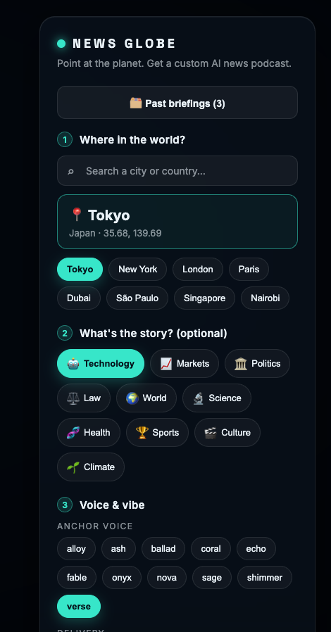
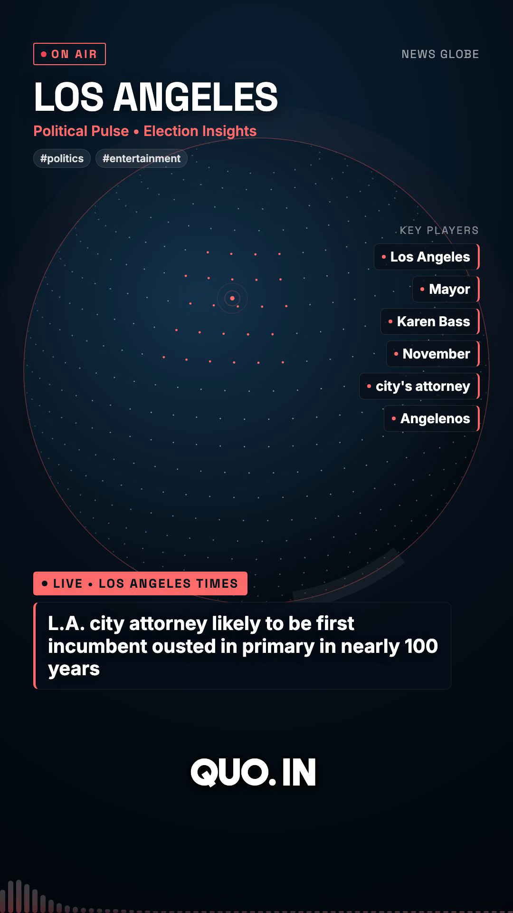

# 🌍 News Globe

[](LICENSE)

**Point at the planet → get a custom AI news podcast, rendered as an animated broadcast.**

<p align="center">
  
  &nbsp;&nbsp;
  
</p>
<p align="center"><em>The control panel (left) and a frame from a generated briefing (right).</em></p>

Click anywhere on an interactive 3D globe, choose your topics, pick a GPT voice, and News Globe will:

1. **📡 Scan the wires** — pull live articles from **multiple sources in parallel** (GDELT + Google News RSS + major-outlet RSS — BBC, Guardian, NYT, NPR, Al Jazeera), merged and deduped. All keyless.
2. **📰 Read the stories** — fetch each article and extract the real body text **and lead photo** (`og:image`), so the briefing is grounded in actual reporting, not just headlines. Google News links are decoded to the real publisher URLs first
3. **🧠 Editor agent** — an LLM editor scores every article for relevance + importance, drops the off-topic ones, and extracts talking points. When coverage is thin it **writes its own search queries and re-searches** — a real plan→act→observe→refine loop
4. **✍️ Write the script** — GPT drafts a tight, fact-grounded broadcast from the editor's rundown
5. **🎙️ Voice it** — OpenAI TTS (`gpt-4o-mini-tts`) reads it as a news anchor
6. **💬 Captions + intelligence** — Deepgram transcribes for word-perfect karaoke captions **and** detects the **key players (entities)**, **topics**, **sentiment**, and an audio **summary**
7. **🎞️ Visual director agent** — a second LLM agent reads the transcript word timings + the downloaded story photos and **plans the shot list**: photo cards (Ken Burns + source credit), verbatim pull-quote cards, and count-up stat callouts, each timed to the moment its story is narrated. Its plan is **validated in code** (missing assets, overlaps, ungrounded quotes, invented numbers) with a repair round when it breaks the rules — and a deterministic fallback so a video always renders
8. **🎬 Render it** — Remotion composites a rotating globe, story photos + quote/stat cues, headline lower-thirds (speech-aligned via the director's story anchors), a live "Key Players" rail, an audio waveform, animated captions, and a closing "Takeaway" card into a vertical MP4
9. **🚀 Publish (optional)** — auto-post the render to TikTok / Instagram / YouTube / etc. via Upload-Post
10. **🕒 Automate (optional)** — schedule recurring briefings with cron (e.g. "Tokyo tech, weekdays at 8am, auto-published")

The captioning + rendering approach is adapted from the `content-automation/video-tools` Remotion kit.

---

## Architecture

```
news_agent/
├── web/        Vite + React UI — the interactive globe (react-globe.gl)
├── server/     Express API — the news → script → voice → captions → render pipeline
└── remotion/   Remotion compositions — the animated news broadcast
```

The browser drives a job over Server-Sent Events, watching each stage live.

## Setup

```bash
cd "news_agent"
npm install            # installs all three workspaces

# .env already holds your OPENAI_API_KEY + DEEPGRAM_API_KEY (copied from content-automation).
# Optional, for precise audio duration: brew install ffmpeg
```

> **Captions:** Deepgram (`nova-3`) transcribes the generated audio for accurate word
> timing. If no `DEEPGRAM_API_KEY` is set or the call fails, captions fall back to an
> estimated timing that still tracks the script — the app always produces a video.

## Run

```bash
npm run dev      # starts the API (:5174) and the web UI (:5173)
```

Open **http://localhost:5173**, click the globe, pick topics + a voice, and hit **Generate Briefing**.

### Other commands

```bash
npm run studio   # open Remotion Studio to tweak the NewsPodcast composition
npm run build    # production build of the web UI
```

## Configuration (`.env`)

| Key | Default | Purpose |
|-----|---------|---------|
| `OPENAI_API_KEY` | — | Script + voice generation |
| `SCRIPT_MODEL` | `gpt-4o-mini` | Chat model that writes the script |
| `TTS_MODEL` | `gpt-4o-mini-tts` | OpenAI voice model |
| `DEEPGRAM_API_KEY` | — | Speech-to-text + intelligence (entities/topics/sentiment/summary) |
| `DEEPGRAM_MODEL` | `nova-3` | Deepgram transcription model |
| `UPLOAD_POST_API_KEY` | — | Upload-Post key for auto-publishing |
| `UPLOAD_POST_USER` | — | **Your** Upload-Post profile username — required to publish (blank = uploads disabled) |
| `TIMEZONE` | `America/Los_Angeles` | IANA tz for scheduled posts/cron |
| `NEWS_SOURCES` | `gdelt,googlenews,outlets` | Which news sources to aggregate (comma-separated) |
| `PORT` | `5174` | API port |

## News sources

News fetching is a pluggable aggregator (`server/lib/sources/`). Enabled sources run in parallel, get normalized to a common shape, merged + deduped by title, ranked (place-mention → has-body → recency), and handed to the editor agent. All current sources are **keyless**:

- **`gdelt`** — GDELT 2.0 DOC API (global, query-based)
- **`googlenews`** — Google News RSS search by place + topics (best targeting/freshness). RSS links point at `news.google.com` interstitials, so they're **decoded to the real publisher URLs** (`sources/googleNewsDecode.js`) before article text + images are extracted
- **`outlets`** — curated RSS from BBC, The Guardian, NYT, NPR, Al Jazeera, selected per topic

Toggle them via `NEWS_SOURCES`. Adding a source = drop a `fetchX({location, topics})` into `sources/` returning `{title, source, url, excerpt, publishedAt, origin}` and register it in `news.js`. (Easy future adds: Hacker News, Reddit, an Apify actor, or a keyed Guardian/NYT/NewsData source.)

## Automation (cron + auto-publish)

The **Automate** section in the UI (and the `/api/schedules` routes) lets you:

- **Auto-publish** a render to social via Upload-Post — toggle it on and pick platforms. (Requires `UPLOAD_POST_USER`; the API key is already in `.env`. Uploads are flagged `is_aigc` since they're AI-generated.)
- **Schedule recurring briefings** with cron — Daily / Weekdays / Hourly at a chosen time. Schedules persist to `server/schedules.json`, re-register on server boot, and each run reuses the exact same pipeline (and can auto-publish).
- **Publish exactly at the chosen time.** When a schedule has auto-publish on, the cron fires a lead time (~15 min) *before* the target so generation finishes in time, then hands Upload-Post a `scheduled_date` equal to the target instant — so the post goes live precisely at the selected time, not whenever the render happens to finish. (Without auto-publish, the cron simply fires at the chosen time to generate.)

Schedule API: `GET/POST /api/schedules`, `PATCH /api/schedules/:id` (enable/disable), `DELETE /api/schedules/:id`, `POST /api/schedules/:id/run` (run now).

## Library (past briefings)

Every finished briefing (manual or scheduled) is saved to a **Library** — open it with the "🗂 Past briefings" button. Each entry shows a poster thumbnail, title, place, topics, and age; click to replay, or ✕ to delete (which also removes the files). Records persist to `server/history.json` (survives restarts), and a poster JPEG is grabbed per render via ffmpeg. API: `GET /api/briefings`, `DELETE /api/briefings/:id`.

## Notes

- Rendered MP4s land in `server/public/output/` and are served at `/output/<id>.mp4`.
- Per-job audio + downloaded story images live in `remotion/public/renders/<id>/` (validated for type, size, and minimum dimensions before they can appear on screen; deleted with the briefing).
- Voices: `alloy, ash, ballad, coral, echo, fable, onyx, nova, sage, shimmer, verse`.

## License

[MIT](LICENSE) © 2026 Andres Gomez Sarmiento
